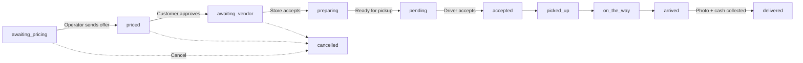
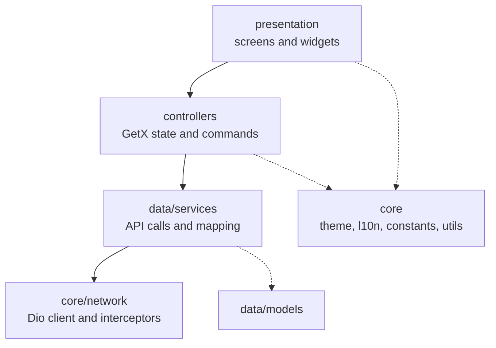

<div align="center">


# AMAR

**A delivery marketplace app for the Gaza Strip, built with Flutter.**
Customers order from local vendors, drivers deliver, and one server keeps everyone in sync.


</div>

---

## Table of Contents

1. [Overview](#overview)
2. [How the platform works](#how-the-platform-works)
3. [Architecture](#architecture)
4. [Project structure](#project-structure)
5. [Tech stack](#tech-stack)
6. [Getting started](#getting-started)
7. [Configuration and secrets](#configuration-and-secrets)
8. [Engineering conventions](#engineering-conventions)
9. [Roadmap](#roadmap)

---

## Overview

AMAR connects three sides of a local delivery market:

| Role | What they do |
|---|---|
| **Customer** | Browses categories, vendors and products, builds a cart, receives a price offer, approves it, and tracks the order live. |
| **Vendor (store)** | Accepts orders, prepares them, and marks them ready for pickup. |
| **Driver** | Receives available orders, picks up, delivers with photo confirmation, and tracks cash and earnings. |

This repository contains the **Flutter client**, which includes the **Customer** and **Driver** apps in a single codebase with two fully separated sessions. It talks to the AMAR REST API at `https://masar.toldpath.com/api/v1`.

**Key product traits**

- Arabic-first with full RTL support, plus English.
- Server-driven behavior: statuses, transitions, polling intervals, enabled modules and currency come from the server's runtime config, not from the app.
- Built for Android and iOS.
- Service area limited to the Gaza Strip (polygon provided by the server config).

---

## How the platform works

An order moves through a lifecycle that is defined by the server. The app reads statuses and allowed transitions at runtime and never hardcodes the sequence.



> The diagram is for understanding only. The real flow is read from `GET /v1/app/config`.

---

## Architecture

The app follows a **layered architecture** where dependencies point in one direction only.



| Layer | Responsibility | Must not |
|---|---|---|
| `presentation` | Rendering only. | Hold business logic or call the API. |
| `controllers` | GetX state and user commands. | Use `BuildContext` or build widgets. |
| `data/services` | API calls and response-to-model conversion. Stateless. | Keep UI state. |
| `core` | Shared infrastructure: network, storage, theme, localization, constants, utilities. | Depend on feature layers. |

### Network layer

A single `ApiClient` (Dio) is shared by the whole app. Cross-cutting behavior lives in separate interceptors:

| Interceptor | Purpose |
|---|---|
| `HeadersInterceptor` | Adds `X-Project-Key`, `Accept-Language`, `X-App-Version`, `X-Config-Version`. |
| `AuthInterceptor` | Attaches the Bearer token that matches the request role. |
| `IdempotencyInterceptor` | Adds an `Idempotency-Key` to retry-sensitive writes. |
| `ErrorInterceptor` | Converts failures to a typed `ApiFailure` and handles `401`. |
| `LoggingInterceptor` | Debug-only logging with sensitive values redacted. |

### Sessions

- Two independent tokens (Customer and Driver) stored in `flutter_secure_storage` under different keys.
- Requests under `/driver/*` use the driver token; everything else uses the customer token.
- Route middleware blocks protected screens without a valid session.
- On `401`, only the affected role's session is cleared.

### Runtime config

On launch the app loads `GET /v1/app/config` before any main screen, with a retry screen on failure. The `AppConfigController` holds the result and refreshes it periodically using `X-Config-Version`.

### Theme and localization

- Design tokens (colors, spacing, radius, sizes, typography) are centralized in `core/theme`.
- Light and dark color sets are defined; the dark theme is prepared but disabled.
- Strings come from ARB files (`ar` and `en`) through `gen-l10n`. Typeface: **IBM Plex Sans Arabic**.

---

## Project structure

```text
lib/
├── main.dart
├── app/                      # App widget, bindings, routes, middleware
├── controllers/
│   ├── customer/             # auth, catalog, profile setup, splash
│   └── shared/               # app config, session
├── core/
│   ├── constants/            # endpoints, headers, query keys, env, storage keys...
│   ├── localization/         # locale controller, error message resolvers
│   ├── network/              # ApiClient, ApiFailure, interceptors
│   ├── storage/              # secure token storage, preferences
│   ├── theme/                # colors, typography, spacing, radius, sizes
│   └── utils/                # logger, validators, formatters
├── data/
│   ├── models/               # auth models + generated Masar models
│   └── services/customer/    # app config, auth, catalog, profile
├── l10n/                     # generated localization
└── presentation/
    ├── screens/              # splash, onboarding, auth, home
    └── widgets/              # auth, common, home
```

Other folders: `env/` (environment files), `l10n_src/` (ARB sources), `tool/` (scripts and git hooks), `assets/`.

---

## Tech stack

| Package | Purpose |
|---|---|
| `get` | State management, navigation, dependency injection |
| `dio` | The only networking layer |
| `flutter_secure_storage` | Secure token storage (Keychain / Keystore) |
| `get_storage` | Non-secret settings such as locale |
| `flutter_localizations` + `intl` | Localization and date formatting |
| `lucide_icons_flutter` | Icon set |
| `cached_network_image` | Network images |
| `connectivity_plus` | Connectivity change signal |
| `uuid` | Idempotency keys |
| `image_picker` | Proof photos and attachments |
| `geolocator` | Driver location (Driver app only) |

---

## Getting started

**Prerequisites:** Flutter 3.27+ (Dart 3.4+), Android Studio or Xcode, and a project key from the team lead.

```bash
# 1. Install dependencies
flutter pub get

# 2. Create your local environment file (git-ignored)
cp env/dev.example.json env/dev.json        # Windows: copy env\dev.example.json env\dev.json

# 3. Add the typeface files to assets/fonts/
#    IBMPlexSansArabic-{Regular,Medium,SemiBold,Bold}.ttf

# 4. Merge localization sources and generate code
pwsh tool/merge_arb.ps1
flutter gen-l10n

# 5. Run
flutter run --dart-define-from-file=env/dev.json
```

**Quality checks**

```bash
flutter analyze
flutter test
dart run tool/check_secrets.dart
```

Enable the secret scan before every commit (once per clone):

```bash
git config core.hooksPath tool/hooks
```

---

## Configuration and secrets

Environment values are injected at build time with `--dart-define-from-file` and read **only** in `lib/core/constants/app_env.dart`.

| Key | Required | Description |
|---|---|---|
| `AMAR_PROJECT_KEY` | Yes | Sent as `X-Project-Key` on every request. |
| `AMAR_DEV_MEMBER` | No | Sent as `X-Dev-Member`, debug builds only. |
| `AMAR_APP_VERSION` | No | Defaults to `1.0.0`. |

Rules for everyone on the team:

- Real keys live only in `env/dev.json`, which is git-ignored. Only `env/dev.example.json` is committed.
- Tokens live only in `flutter_secure_storage`.
- Keys, tokens, OTP codes and passwords never appear in code, docs, logs, screenshots or chat.
- If a secret reaches Git or a shared place even once, treat it as compromised and ask for a key rotation.

---

## Engineering conventions

- **No hardcoded values.** Colors, sizes, strings, durations, endpoints and headers come from constants, theme tokens or ARB files.
- **One widget, one file.** UI parts are small custom widgets, not long inline trees.
- **Controllers stay UI-free.** No `BuildContext` and no widgets inside controllers.
- **One networking path.** No extra `Dio` instances outside `core/network`.
- **Scope discipline.** Nothing is built that is not in the approved specification.
- **Commit messages** follow the Conventional Commits style, for example `feat: add OTP screen` or `fix: handle expired session`.

---

## Roadmap

| Phase | Scope | Status |
|---|---|---|
| 1. Foundation | Packages, theme, localization, constants, storage, network layer, bindings, routes, secret handling | Done |
| 2. Authentication and config | App config, customer OTP, profile setup, session guards | In progress (customer flow built) |
| 3. Customer | Catalog, addresses, cart, quote, orders, offers, tracking, notifications, profile, vendor application | Planned |
| 4. Driver | Sign-in, status, orders, transitions, location, cash and earnings | Planned |
| 5. Polish | UI states, performance, RTL and LTR review | Planned |
| 6. Quality assurance | Tests and analysis on Android and iOS | Planned |

---

<div align="center">

Built by the AMAR team in Gaza.

</div>
