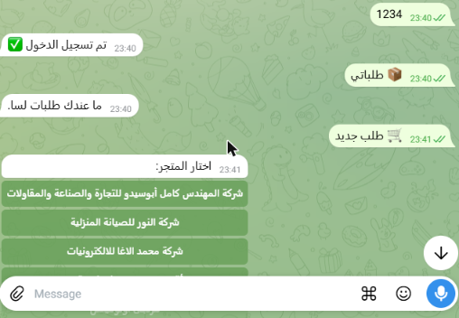
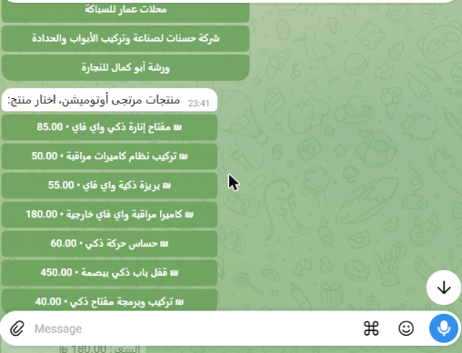
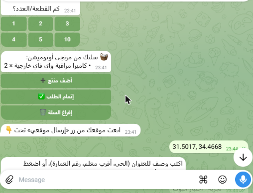
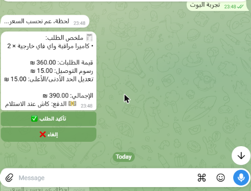
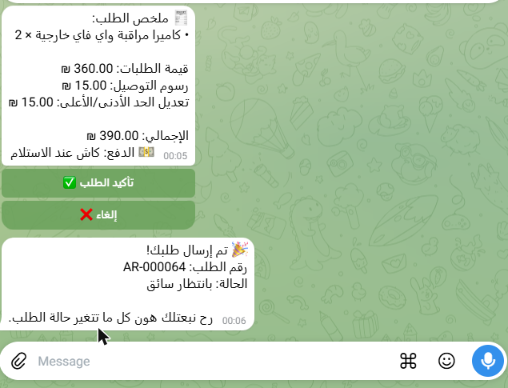

# Telegram bot: test report

**Date:** 2026-11-09 · **Bot:** [@amar_gaza_order_bot](https://t.me/amar_gaza_order_bot) · **Branch:** `feat/telegram-bot`
**Result:** ✅ Pass. A full order was placed from Telegram and reached Masar.

| # | Step | Result |
|---|------|--------|
| 1 | `/start`, share phone, OTP | ✅ Signed in |
| 2 | 📦 My orders (empty account) | ✅ "No orders yet" |
| 3 | 🛒 New order: vendor list (8 vendors) | ✅ |
| 4 | Product list with prices, pick a quantity (2) | ✅ |
| 5 | Cart summary + checkout | ✅ |
| 6 | Location as typed coordinates (Telegram Web/Desktop) | ✅ (fixed during the test) |
| 7 | Address description | ✅ |
| 8 | Price summary: 360 + 15 delivery + 15 min. adjustment = **390 ₪**, cash | ✅ Matches the API quote |
| 9 | Expired quote, then confirm | ✅ Re-quoted automatically |
| 10 | Confirm order | ✅ **AR-000064**, waiting for a driver |

## Fixed during the test

- Telegram Web/Desktop cannot share a location. The bot now also accepts
  `lat, lng` or a Google Maps link as text.
- A request hung on a dropped connection and the bot went silent. Idle
  sockets now close after 5s, and a timed-out request retries once.

## Not covered yet

- The status-change message (change AR-000064 in the dashboard; the bot
  polls every 30s).
- Price offers (approve/reject) for service orders.
- The bot runs on a dev laptop for now. Production needs an always-on host.

## Screenshots

| Login + vendors | Products | Cart + location | Price summary | Order placed |
|---|---|---|---|---|
|  |  |  |  |  |
